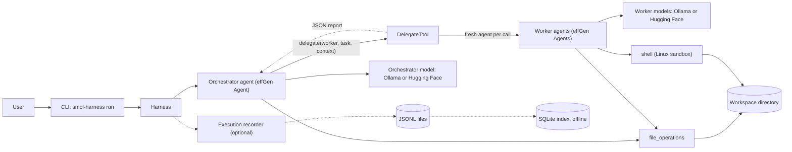

# smol-harness

smol-harness is a small multi-agent coding harness built on [effGen](https://github.com/ctrl-gaurav/effGen) 1.3.0. A larger "orchestrator" model receives a task and delegates self-contained pieces of it to smaller "worker" models through a single `delegate` tool. Each worker runs in its own fresh context, with its own model, quantization, tool allowlist and limits. The orchestrator sees only a short JSON report from each worker.

The design follows the managed-agents pattern of smolagents. The project is research oriented: it exists to study how well small, locally hosted, quantized models can do useful coding work when a larger model plans and coordinates. effGen supplies the agent loop, model adapters and tool base classes; this repository adds configuration, delegation, tools, wiring, a command line and optional execution-history recording. It is an experimental harness, not a finished product.

## Features

Everything listed here is implemented and covered by the default test suite (scripted models, CPU only). Real-model coverage is described under [Experiments and validation status](#experiments-and-validation-status).

- **Orchestrator-worker delegation.** The orchestrator holds a `delegate` tool; every call builds a fresh worker agent. Delegation depth is 1 and workers run one at a time.
- **Independent worker contexts.** A worker shares the loaded model weights with other agents that use the same model spec, but never conversation state.
- **Two model backends.** Ollama (through effGen's OpenAI-compatible adapter) and local Hugging Face Transformers. Each agent has its own model entry, so orchestrator and workers can use different providers.
- **Per-agent quantization.** Hugging Face models: none (bf16/fp16, or fp32/bf16 on CPU), bitsandbytes 8-bit, bitsandbytes 4-bit NF4. Ollama models: the quantization is whatever the model tag selects.
- **Tools.** `file_operations` confined to a workspace directory, `edit_file` (exact single-occurrence text replacement, no whole-file rewrite), and `shell`, a restricted Linux-only shell (see [Tools and security](#tools-and-security)). Each agent has an explicit tool allowlist. No web or network tools are ever registered.
- **Execution limits and failure handling.** Maximum delegations per run, maximum report size, a cooperative per-worker timeout, and per-agent iteration caps. Every worker failure (timeout, unknown worker, a stopped run, an exception) is returned to the orchestrator as a structured report instead of ending the run.
- **Tool-input guards.** A `delegate` call over effGen's 10,000-character tool-input limit, or one whose JSON is malformed, is refused before a worker starts. Malformed JSON written to `file_operations`, `edit_file` or `shell` is refused before the tool acts.
- **Optional JSONL execution history.** `--history-dir` records a run as JSONL files.
- **SQLite analysis.** `experiments/history/history.py` imports those files into a local SQLite index and prints per-session timelines.

## Architecture



The modules under `src/smol_harness/` are:

| Module | Role |
|---|---|
| `config.py` | Loads and validates the YAML configuration into frozen dataclasses. |
| `models.py` | Maps a model spec to an effGen model, with explicit quantization and device placement, and shares equal specs through a cache. |
| `tools.py` | Builds each agent's tool list from the allowlist; contains the restricted `shell` tool. |
| `delegation.py` | `DelegateTool`, the worker registry, the cooperative deadline and report bounding. |
| `harness.py` | Wires orchestrator, workers and tools; `Harness.run(task)`. |
| `recorder.py`, `redaction.py` | Optional execution recorder and the shared redaction policy. |
| `__main__.py` | The command line. |

The agent loop, tool-calling parsers and model adapters are effGen's. The harness runs effGen in ReAct tool-calling mode, which is the mode verified with the small local model used so far.

## Requirements

Required:

- Python 3.12 (the project pins `>=3.12,<3.13`).
- [uv](https://docs.astral.sh/uv/) for environment and dependency management.
- Linux, if you want the `shell` tool (see below).
- Disk space and bandwidth for the locked environment. `uv sync --locked` installs effGen with PyTorch and the NVIDIA wheels, a multi-gigabyte download.

Optional, depending on the backends you configure:

- **Ollama backend:** a running Ollama server (default `http://127.0.0.1:11434/v1`) with the model tag already pulled. The configured `context_length` must not exceed the context window the server actually serves.
- **Hugging Face backend:** model weights downloadable or cached locally. With `device: cuda` (the default) an NVIDIA GPU with a working CUDA PyTorch is required; the harness does not fall back to CPU. With `device: cpu`, only `quantization: none` is accepted and an explicit `dtype` is required.
- **4-bit and 8-bit quantization:** `bitsandbytes` and a CUDA GPU. `bitsandbytes` is not in the lock file; install a pinned version yourself if you need it. (The old RTX 4070 package that did this is historical and not an active target.)

Native Windows is not supported for the `shell` tool: building it there fails closed with an error. The `file_operations` tool and the scripted tests are not Linux specific, but nothing in this repository has been verified on Windows or WSL2 for the shell.

## Installation

```bash
git clone <repository-url>
cd smol-harness
uv sync --locked
uv run python -c "import effgen; print(effgen.__version__)"   # prints 1.3.0
```

## Quick start

The only example configuration is [`configs/example.yaml`](configs/example.yaml). It uses an Ollama orchestrator (`qwen2.5-coder:7b-instruct-q4_K_M`) and a Hugging Face worker (`Qwen/Qwen2.5-Coder-1.5B-Instruct`, NF4), so running it as is needs an Ollama server with that tag, a CUDA GPU, `bitsandbytes` and the worker weights. Its model ids are examples; edit the `model` entries to match what you have. Its pairing has not been verified to fit in 8 GB of VRAM.

The workspace is `../workspace` relative to the config file, that is `workspace/` in the repository root. It must exist before a run:

```bash
mkdir workspace
uv run smol-harness run \
  --config configs/example.yaml \
  --task "Create hello.txt containing the text hello, then tell me what you wrote."
```

What you get:

- **stdout** is only the orchestrator's final answer (or one JSON document with `--json`).
- **stderr** carries a per-delegation summary (`d1 coder: completed (iterations N, tool calls M)`), failures and warnings.
- **Exit codes:** 0 the orchestrator finished successfully, 1 the task failed, 2 usage error, 3 start-up failure (configuration, tools, model loading), 4 the run raised an exception, 130 interrupted.

Exit code 0 and `success: true` mean the orchestrator finished and reported an answer. They do not mean the task was achieved or independently checked. A small model can answer without delegating, or report work it did not do, and the CLI still exits 0. Verify the workspace yourself.

`python -m smol_harness run ...` is equivalent to the `smol-harness` command.

## Configuration

A single YAML file describes the workspace, the limits, one orchestrator and a list of workers. [`configs/example.yaml`](configs/example.yaml) is commented and is the reference. In summary:

- **Models.** Each agent has `model.provider` (`ollama` or `hf`). Ollama entries take `model`, a required `context_length`, `base_url`, and `quantization: server`. Hugging Face entries take `model`, a required `quantization` (`none`, `bnb-8bit`, `bnb-4bit-nf4`), `device` (`cuda` or `cpu`) and `dtype`. Invalid combinations are rejected at load time.
- **Routing.** Routing is static: each agent is bound to the model in its own entry, and `delegate` names the worker. Agents with equal model specs share one loaded instance.
- **Tools.** Each agent lists its `tools` (`file_operations`, `edit_file`, `shell`). `delegate` is implicit for the orchestrator and not allowed for workers.
- **Limits.** `max_delegations`, `max_report_chars`, `worker_timeout_s`, and per-agent `max_iterations`. `max_depth` is fixed at 1. The worker timeout is cooperative: it is checked before each model or tool call and does not interrupt one in flight.
- **Workspace.** A directory that must already exist. Filesystem roots and the home directory (or its ancestors) are refused.

Sampling parameters, `max_tokens` and Hugging Face context limits are not configurable in YAML yet.

## Tools and security

- **`file_operations`** is effGen's file tool, built through `tools.build_tools` so it is confined to the workspace. Paths that escape it, by `..`, absolute paths or symlinks, are refused for reads and writes. This is path validation, not a sandbox, and it does not defend against a hostile local process racing the check. The tool refuses extensionless files such as `Makefile`.
- **`edit_file`** takes `path` (relative to the workspace), `old_text` and `new_text` and replaces `old_text` where it occurs **exactly once** in an existing UTF-8 text file; a missing or ambiguous `old_text`, a missing file, an absolute or `..` path, a symbolic link (the file or any parent directory), a directory, FIFO, hard-linked, read-only, binary or oversized file, and a file under `.git` are refused and nothing changes. Line endings and whitespace are never normalised (a CRLF file needs `\r\n` in `old_text`). The call's arguments travel as JSON, and effGen reads text that is not valid JSON leniently, so a backslash copied from a file as it reads (`\x1b`) can reach the tool as a control character. The tool's description and refusal messages no longer tell the model how to escape backslashes; that guidance now lives only in the worker prompt of the `rich_3278` pilot driver. A `new_text` containing a C0 control character other than TAB, LF and CR is refused (the tool never writes one, and says why, naming the characters but never quoting the file); an `old_text` that holds one and does not match gets the same explanation. Not detected: escapes that decode to ordinary characters (`\x41` becomes `A`, a single-backslash `\t` or `\n` becomes TAB or LF), because they cannot be told apart from intended text after parsing. The new content replaces the file atomically after the file is found unchanged since it was read; this detects, it does not lock. POSIX only. It is not a sandbox, and it does not special-case credential-shaped file names the way `file_operations` does.
- **Structured tools** (`file_operations`, `edit_file`, `shell`) must receive one JSON object. A call whose input begins with `{` but does not parse as JSON (typically an `Action`/`Observation` line concatenated after it) is refused with an explicit error and no file or command operation occurs.
- **`shell`** runs `bash -c <command>` inside effGen's Linux-namespace sandbox. It starts in the workspace, can write only inside it, has no network (DNS included), runs in a private PID namespace, has a wall-clock timeout that kills every process the command started, a memory limit (`ulimit -v`, 1 GiB by default), tail-truncated output and an empty stdin. It needs Linux with unprivileged user namespaces, plus `bash`, `unshare` and GNU `timeout` on `PATH`. A pre-flight check must show these guarantees before the first command runs.
- **Fail closed.** If the sandbox cannot be established, building the `shell` tool raises an error. The harness never substitutes an unrestricted shell, and effGen's own `BashTool` is never used because it is not a sandbox. On native Windows the `shell` tool is refused.
- **Not complete isolation.** Reads are not confined (the shell can read files `file_operations` refuses, such as `.env`), Unix sockets outside `/run` remain reachable, and the sandbox has not been tested against an adversarial workload. The shell is for trusted local development and controlled test repositories only. Do not run untrusted repositories or adversarial agents with it; use a separately verified container or VM for that.
- **No web or network tools** are registered anywhere.

## Execution history and SQLite

Recording is off by default. With `--history-dir`, a run is written as JSONL; a separate offline script indexes it into SQLite.

```bash
uv run smol-harness run --config configs/example.yaml --task "..." \
  --history-dir ~/smol-history [--capture-prompts]
python experiments/history/history.py import ~/smol-history --db ~/smol-history/history.db
python experiments/history/history.py sessions --db ~/smol-history/history.db
python experiments/history/history.py timeline <session id> --db ~/smol-history/history.db
```

The CLI prints `history: <folder>` on stderr. Each process writes one private folder (mode 0700) containing `trace.jsonl` and `attempts.jsonl`. The recorder is an effGen middleware; it never changes prompts, arguments, results, answers or exit codes, and any recorder error stops recording with a warning instead of failing the run. The importer is stdlib `sqlite3`, rebuildable from the JSONL, and also offers `usage`, `issues`, `rebuild` and `purge`.

What the history does and does not contain:

- Worker events are attributed to the `delegate` call that started them. Delegation ids are recorded only once the returned report confirms them, and stay empty for an interrupted delegation.
- The middleware sees the string a tool returns, not a success flag. Tool outcomes are therefore stored as unknown (`returned`), never as success. The timeline prints a clearly marked heuristic when a result reads like an error.
- The raw model text before effGen cut it at a stop sequence is not available, nor is retry history inside one model call or the provider's final payload. Token usage and cost appear only when the provider reported them; local models usually report no cost, and the database stores NULL rather than a guess.
- If the delegation context does not reach a worker (for example `Harness.run` called under a running asyncio event loop), the worker is recorded with role `unknown` and listed as an attribution issue.

Prompt privacy and redaction:

- Exact prompts are stored only with `--capture-prompts` (which requires `--history-dir`), in a separate `prompts.local.jsonl` (mode 0600), with a SHA-256 per prompt that the importer verifies.
- Trace and attempts lines pass through one shared redaction policy ([`src/smol_harness/redaction.py`](src/smol_harness/redaction.py)): common token formats, bearer headers, URL passwords, private keys, the values of sensitive environment variables, and the home directory. Redaction is pattern based; tool results can still contain anything a tool read, so treat history folders and databases as private.
- Captured prompts are not redacted, so the hash stays verifiable. `*.local.jsonl` and database files are Git-ignored and are excluded from the experiment archives. Do not share them.

Details, table definitions and retention behaviour: [`experiments/history/README.md`](experiments/history/README.md).

## Experiments and validation status

- **Scripted-model tests (completed).** The default test suite drives the real effGen loop, delegation, tools, sandbox and CLI with scripted models. This is what the feature list above is verified against.
- **Local real-model experiments (completed, negative result).** `LiquidAI/LFM2.5-350M` on CPU, in ReAct mode, drove the harness mechanically (valid tool calls were parsed and executed, worker records and cleanup worked) but succeeded at none of the tool-use or delegation tasks in 12 recorded attempts. Details are in [`docs/implementation-plan.md`](docs/implementation-plan.md) (task T5.2b). No real model has completed a coding task through the harness.
- **DGX Spark diagnostics (run once, Qwen3 only).** [`experiments/dgx/`](experiments/dgx/README.md) contains a preflight (E0), a single-agent file read (E1), an orchestrator-worker delegation (E2) and a repeated context-transfer test (E3). On 2026-10-30 E0, E2 and a five-trial E3 repeat were run on a DGX Spark with `smol-qwen3-14b:8k` (Ollama): the delegation mechanics worked, and E3 passed 4 of 5 trials (one trial exhausted its reasoning budget before delegating). These are smoke tests on one model and do not include a coding task.
- **`rich_3278` coding-evaluation pilot (three real-model execution attempts, none produced a candidate patch).** [`experiments/coding_eval/`](experiments/coding_eval/README.md) is a single-task pilot on a dataset task: a sandboxed agent plus an independent Docker evaluator. On 2026-11-05 it ran twice on a DGX Spark, in the driver's Docker agent sandbox, with the artifacts committed under [`gemma_eval_runs/`](gemma_eval_runs/): `gemma4:e4b` completed the agent phase but produced an empty candidate patch (classification `indeterminate`: a worker timed out and its cause is not established), and `qwen3.8:27b` hit a model-call timeout (`infrastructure_failure`). Neither changed a file, so the evaluator never ran tests. A third attempt on 2026-11-11 (`gemma4:e4b`, run `e0cf`, in the git-ignored `new_gemma_eval_runs/`) also produced an empty patch, after a tool-interface failure (malformed or double-escaped JSON), and with a worker prompt that contained the reference fix line (since removed). These are execution attempts, not coding evaluations. The Docker agent sandbox was redesigned afterwards (narrower mounts, create/inspect/verify/start, kill and remove in a `finally`) and, in its full current configuration, has never run in a container (a reduced-fidelity check on x86_64 under Docker Desktop on 2026-11-13 is described in [`experiments/coding_eval/README.md`](experiments/coding_eval/README.md); the ID-based cleanup has only run against a stubbed `docker`). The pilot driver has a `--tool-calling-mode` option (default `react`); no native or hybrid run has been made against Ollama. The step-by-step procedure for the pilot is in [`instructions.md`](instructions.md).
- **RTX 4070 package (historical).** [`experiments/rtx4070/`](experiments/rtx4070/README.md) was prepared for a WSL2 machine that is no longer available. It was never run on hardware, is excluded from active workflows, and is kept for provenance. Some of its code is still imported by `experiments/dgx/` and by tests, so it cannot simply be removed.

Not yet verified at all: the full current Docker agent sandbox configuration in a container (system and venv mounts, the Python agent-child; only a reduced-fidelity check has run), a bitsandbytes GPU load, a mixed Ollama plus Hugging Face delegation with real models, and the shell on Windows or WSL2. The harness has reached Ollama on a DGX Spark with Qwen3 14B, Qwen3.8 27B and Gemma 4 e4b; no other provider or model has been exercised with a real model. No real model has completed a coding task through the harness.

## Limitations

- Workers run sequentially and delegation depth is 1.
- The worker timeout is cooperative; a long generation or tool call can overrun it by one call. There is no orchestrator deadline.
- The shell sandbox is not complete isolation (see above) and is Linux only.
- effGen's native tool calling cannot read the small test model's default call format, so the harness uses ReAct mode. Tool calling through Ollama (ReAct mode) has been exercised with Qwen3 14B and Gemma 4 e4b on a DGX Spark; Qwen3.8 27B reached the endpoint but its first call timed out before any tool use. No other provider or model has produced a real tool call.
- A successful exit does not imply a correct result; the harness has no built-in task verification.
- A `delegate` call whose input exceeds 10,000 characters (effGen's tool-input limit, counted on the JSON the model writes) or whose JSON is malformed is refused with an explicit error; the orchestrator must shorten the task and context, or write one valid JSON object. Context between workers travels only through the orchestrator, as text it writes into the next delegation.
- The process-wide effGen loop patch is required so identical repeated calls of `shell`, `file_operations` and `delegate` actually run. The CLI installs it; library users must call `smol_harness.harness.initialize_runtime()` first. It is pinned to effGen 1.3.0 and fails loudly on any other version.
- Execution history cannot report tool success, raw model text or the provider payload (see above).
- Persistent memory, context compaction, recursive hierarchies, checkpointing and web access are intentionally out of scope.

## Development and testing

```bash
uv sync --locked
uv run pytest -q             # default suite: CPU only, no network, no real model
uv lock --check              # after any dependency change
```

Some tests need Linux user namespaces and `git`; they fail or skip with a reason elsewhere. Real-model tests live in `tests/integration/`, are marked `real_model`, and are skipped unless you pass `--run-real-models` (or set `SMOL_RUN_REAL_MODELS=1`). They may download model weights, so run them deliberately:

```bash
uv run pytest tests/integration/test_liquid_cpu.py --run-real-models -s
```

Further reading: [`docs/architecture.md`](docs/architecture.md) (design and decisions), [`docs/implementation-plan.md`](docs/implementation-plan.md) (tasks and status), [`docs/effgen-api-audit.md`](docs/effgen-api-audit.md) (verified effGen behaviour) and [`docs/new-session.md`](docs/new-session.md) (current state).

## License

This repository does not currently contain a license file, and `pyproject.toml` declares no license. Until one is added, no permission to use, copy or distribute the code is granted beyond what applies by default.
