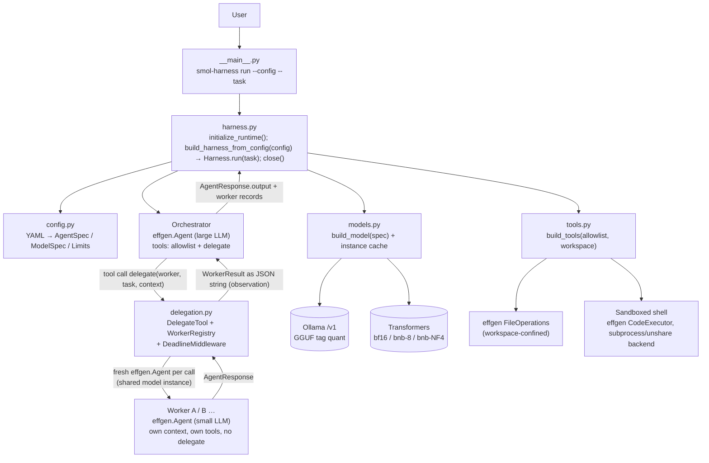
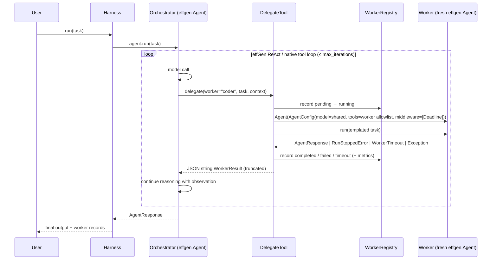

# Architecture

> **Status:** proposed. **No component below is implemented yet.**
> Mark a component *Implemented* only after its task in `docs/implementation-plan.md` is Completed.
> Facts about effGen and the source references behind them are in `docs/effgen-api-audit.md`.

## 1. Analysis of the smolagents reference diagram

The supplied diagram (gitdiagram of `huggingface/smolagents`) shows four layers.

| smolagents component | Responsibility | MVP? | effGen equivalent | Decision |
|---|---|---|---|---|
| CLI (`cli.py`) | Submit a task, run an agent | Yes (tiny) | `effgen` CLI exists but is effGen-centric | **Own ~50-line argparse CLI** |
| Gradio UI (`gradio_ui.py`) | Streams a run in the browser | No | `effgen/webui`, dashboard | Dropped |
| Web browser agent | Browser automation | No | — | Dropped (excluded) |
| Agent runtime (`agents.py`) | Multi-step ReAct loop, tool dispatch, managed agents | Yes | `Agent` loop (`core/agent*.py`) | **Reuse effGen** |
| Run memory (`memory.py`) | Per-agent step history | Yes | `AgentThread`, `ShortTermMemory` | **Reuse effGen** |
| Monitoring (`monitoring.py`) | Token/step tracking | Minimal | `AgentResponse` metrics, `ExecutionTracker`, ledger | **Reuse effGen**; no custom observability |
| Model adapters (`models.py`) | LLM provider abstraction | Yes | `effgen.models.load_model`, adapters | **Reuse effGen**; one thin `build_model(spec)` function |
| MCP client (`mcp_client.py`) | Tools from MCP servers | No | `tools/protocols/mcp*` | Dropped (excluded) |
| Multimodal types (`agent_types.py`) | Image/audio I/O | No | `core/messages.py` | Dropped |
| Serialization (`serialization.py`) | Safe result transport for remote executors | No | — | Dropped (no remote execution) |
| Tool framework (`tools.py`) | Tool base class, schemas | Yes | `BaseTool`, `@tool` | **Reuse effGen** |
| Default tools (`default_tools.py`) | Built-in tools incl. web search | Partial | `tools/builtin/*` | Reuse file ops + sandboxed shell; **no web tools** |
| Tool validation (`tool_validation.py`) | Validate tool definitions | Implicit | `ParameterSpec.validate`, `BaseTool.execute` | **Reuse effGen** |
| Local code executor | Run model-written Python | No (we are a tool-calling, not code-acting, harness) | `CodeExecutor` | Used only as the sandboxed **shell** backend |
| Remote executors + sandbox services | E2B/Docker/Modal | No | `DockerSandbox` | Dropped (excluded) |
| Hugging Face Hub | Share agents/tools | No | — | Dropped |
| LLM providers | Inference | Yes | Ollama (OpenAI-compatible), Transformers | **Reuse effGen** |

**What the diagram does not show** (taken from source: `src/smolagents/agents.py`):

- `MultiStepAgent(managed_agents=[...])` registers each managed agent as a tool. `_setup_managed_agents` gives it `inputs={task, additional_args}` and `output_type="string"`.
- The manager calls the agent like a tool (`execute_tool_call`, the `is_managed_agent` branch).
- `MultiStepAgent.__call__`:
  1. wraps the task in the `managed_agent.task` prompt template;
  2. calls `self.run(full_task)`, where `reset=True` by default, so **each delegation starts with fresh memory**;
  3. wraps the output in the `managed_agent.report` template;
  4. optionally appends a run summary (`provide_run_summary`).
- An exception becomes the observation "Error executing request to team member ... try again or request another team member".
- Managed agents may have their own managed agents; there is no depth cap and no timeout.

### Principles adopted from smolagents

1. **A worker is just a tool to the orchestrator.** Delegation happens inside the orchestrator's normal loop. The orchestrator sees the result as an observation and keeps reasoning.
2. **Fresh context per delegation.** The worker never sees parent history except the explicit task/context text. The parent never sees worker history except the returned report.
3. **Templated task and report envelopes**, so small workers get a clear contract.
4. **Errors become observations**, not crashes. The manager decides what to do next.

### Ideas borrowed from Pi (not in smolagents)

`pi-mono/packages/coding-agent/examples/extensions/subagent`:

- A **single** `delegate(worker, task)` tool addressing named workers, instead of one tool per worker. This keeps the orchestrator's tool list short.
- A **cap on returned child output** (Pi uses 50 KB). We cap the report at a configurable number of characters.
- Declarative worker definitions (name, description, model, tools). We put these in one YAML config file.
- Exact-match `oldText → newText` edit tool (`src/core/tools/edit.ts`). This is a *candidate* for task T4.3 if whole-file writes prove unreliable.

## 2. Why not effGen's built-in orchestration

Evidence and source references are in `docs/effgen-api-audit.md` §1.3.

- `SubAgentManager` does an up-front router decomposition, always runs on the **parent's model and tools**, and ignores per-subagent `model`, `tools` and `timeout`. That rules out heterogeneous workers.
- `MultiAgentOrchestrator` with the `HIERARCHICAL` pattern runs fixed decompose → run-all → synthesize phases with text-parsed subtasks. There is no mid-run delegation, and `TeamConfig.timeout` is not enforced. We keep it as a possible **comparison baseline** after MVP.
- **effGen explicitly supports an agent being run from inside another agent's tool.** Run scopes are keyed per agent, nested trackers are separate, and `FunctionTool` copies the context so the child is counted in the parent's ledger. That makes a ~100-line delegate tool the smallest correct solution.

## 3. Proposed architecture



Each box is effGen's code unless it names one of our modules: `cli.py`, `harness.py`, `config.py`, `models.py`, `tools.py`, `delegation.py`. The custom code target is **≤ ~600 lines of Python**, excluding tests.

### Proposed package layout (not yet created)

```
pyproject.toml                 # uv project; pins effgen==1.3.0 (or the audited commit)
src/smol_harness/
  __init__.py
  config.py      # dataclasses + YAML loader + validation
  models.py      # build_model(spec) -> effgen BaseModel; quant mapping; cache
  tools.py       # build_tools(names, workspace); pinned sandboxed shell
  delegation.py  # WorkerResult, WorkerRegistry, DeadlineMiddleware, DelegateTool
  harness.py     # wire orchestrator + workers; Harness.run(task) -> HarnessResult
  recorder.py    # optional execution history: an effGen middleware writing JSONL (Phase 2)
  redaction.py   # the one stdlib-only redaction policy (recorder + experiment driver)
  __main__.py    # CLI
configs/example.yaml
tests/           # unit tests use scripted effGen BaseModel fakes (no GPU / network)
```

## 4. Component responsibilities

| Module | Responsibility | Must NOT |
|---|---|---|
| `config.py` | Parse and validate one YAML file into frozen dataclasses (T3.1, built): `ModelSpec(provider, model, quantization, base_url, context_length, dtype)`, `AgentSpec(name, model, tools, max_iterations, description, system_prompt)`, `Limits(max_delegations, max_report_chars, worker_timeout_s, max_depth)`, `HarnessConfig(workspace, orchestrator, workers, limits)`. Errors are `ConfigError` with a dotted path. Rejects unknown tools / web-browser tools / `delegate` on workers, unsupported or cross-provider quantization, duplicate names (also duplicate YAML keys), non-finite or out-of-range limits. See §8 for the schema decisions. | Load models, construct agents or tools, touch the filesystem or network |
| `models.py` | `build_model(spec) -> effgen BaseModel` via `effgen.models.load_model` (T3.2, built): `loader_args(spec)` is the pure spec→kwargs mapping, `ModelLoadError` wraps failures (cause preserved), `ModelCache` (explicit, spec-keyed, owns and unloads its models). Maps our quantization to `quantization_bits` (always passed for hf), passes `require_gpu=True`, refuses effGen-rewritten Ollama ids, and verifies the returned model's kind and quantization. | Implement inference, a provider base class, quantization, retries or fallbacks |
| `tools.py` | `build_tools(names, workspace) -> list[BaseTool]` from a fixed registry: `file_operations`, `shell` (later maybe `edit_file`). | Register web or network tools; implement path checks effGen already does |
| `delegation.py` | `DelegateTool` (an effGen `BaseTool`), `WorkerResult` / `WorkerRecord`, `WorkerRegistry` (in-memory lifecycle: `pending → running → completed / failed / timeout`), `DeadlineMiddleware`. | Run its own reasoning loop; merge histories |
| `harness.py` | Build the orchestrator and worker factories from config (`build_harness_from_config`, T5.0: tools first, then models via one `ModelCache`, then `AgentConfig`s with the effGen settings stated explicitly). `Harness.run(task) -> HarnessResult(output, success, termination, workers=[WorkerRecord...])`; `Harness.close()` unloads only a cache it created. `initialize_runtime()` installs the explicit, process-wide effGen loop patch (F1) that the builder and `run` require. | Re-implement `Agent.run`; install the patch implicitly; close a caller's cache |
| `recorder.py` | Optional (`--history-dir`): `ExecutionRecorder`, an `AgentMiddleware` on every agent plus `begin/finish/abort` called by `Harness.run`. Writes `trace.jsonl` / `attempts.jsonl` (and opt-in private `prompts.local.jsonl`) that `experiments/history/history.py` imports into SQLite. Worker events are attributed to their `delegate` call through a `ContextVar`; per-run state lives on `RunContext.metadata`. Any recorder error disables it and never reaches the run. | Change a prompt, argument, result or return value; predict delegation ids; claim a tool succeeded; implement tracing beyond JSONL lines |
| `redaction.py` | `redact`, `redact_obj`: credentials and personal paths removed from anything shared. Stdlib only; `experiments/rtx4070/rtx4070.py` loads it by path. | Be weakened for one caller |
| `__main__.py` | The CLI (T5.1; `--history-dir` / `--capture-prompts` added in history Phase 2): `smol-harness run --config FILE --task TEXT [--json]` / `python -m smol_harness run ...`. Calls `initialize_runtime()`, `load_config()`, `build_harness_from_config()` and runs the task in `with harness:`; stdout = the answer (or one JSON document), stderr = delegation summary and diagnostics; exit codes 0 ok, 1 task failed, 2 usage, 3 start-up, 4 run raised, 130 interrupted. | Re-implement loading, delegation, tools or cleanup; print tracebacks, environment or full reports |

## 5. Orchestrator-worker execution flow



### Delegate tool contract (implemented except `duration_s`; `timeout` status T2.1, `delegation_id` T2.2, `truncated` and limits T2.3)

- **Input:**
  - `worker`: enum of configured worker names.
  - `task`: string; must be self-contained.
  - `context`: optional string with the explicit context transfer, e.g. file paths and findings.
- **Output:** a JSON string, deliberately *not* a dict (audit §1.2):
  ```json
  {"delegation_id": "d1", "worker": "coder", "status": "completed|failed|timeout",
   "output": "...(truncated to max_report_chars)", "error": null,
   "termination": "done", "iterations": 4, "tool_calls": 3, "tokens_used": 2100, "duration_s": 41.2}
  ```
- **Failure semantics:**
  - The tool itself does **not** report `success: False` to effGen. A failed worker is a *successful* tool call whose payload says `status: "failed"`. This keeps effGen's `tool_failed` termination from ending the orchestrator run because of a worker failure. The orchestrator decides whether to retry, re-delegate or answer. **Verify in T2.2.**
  - **As implemented in T1.2:** an unknown worker name or a blank task is also a structured `status: "failed"` result (`error_type` `unknown_worker` / `invalid_arguments`). Missing or non-string `worker`/`task` are rejected by effGen's own parameter validation, which returns a failed `ToolResult` (error text, not JSON). `max_delegations` (T2.3) is not built yet.
- **`delegation_id` is load-bearing, not cosmetic (T2.2):** effGen ends a run whose tool "returned the same result twice" (`stop_reason=repeated_tool_result`, `termination=stuck`). Without a unique id, two identical reports from different delegations (e.g. two failures, or two "all tests passed") would stop the orchestrator. The id (`d1`, `d2`, ... per run) keeps every report distinct.
- **Task envelope:** a smolagents-style template. It says who the worker is and that it is helping a manager, then gives the task and context, and asks for an outcome with a short summary, details, files touched, and anything unresolved.

## 6. Subagent spawning strategy

- **Workers are preconfigured specs.** "Spawning" means constructing a fresh `effgen.Agent` from a spec at delegation time. That gives dynamic *instances* of static *definitions*. Free-form runtime-defined workers (model picks model or tools) are post-MVP.
- **Depth = 1 is enforced structurally:**
  - Only the orchestrator holds `delegate`.
  - Workers are built with `enable_sub_agents=False` and `mode=AgentMode.SINGLE`, and `config.py` rejects `delegate` in a worker tool list.
- **Execution is sequential.** effGen runs a turn's tool calls through `_execute_tool` one by one, and the Transformers engine serializes generation anyway. Parallel execution is post-MVP; effGen's `SubAgentManager.execute_parallel` / thread executors are the pattern to study then.
- **Lifecycle (as implemented in T1.3):** the registry holds definitions only. `DelegateTool` appends one `WorkerRecord(worker, task, context, result)` per finished delegation (`completed` or `failed`) to a **per-run** list owned by `Harness.run`, which also builds a fresh orchestrator `Agent` per run. Exposed as `HarnessResult.workers`. No persistence. Since then: the `timeout` status (T2.1) and `delegation_id` (T2.2). Still planned: timing (`duration_s`).

## 7. Context isolation strategy

| Concern | Mechanism |
|---|---|
| Separate histories | A new worker `Agent` per delegation (its own `ShortTermMemory` / `AgentThread`). The `Agent` is closed afterwards; the model instance survives (`close()` does not unload). |
| Explicit transfer | Only `task` + `context` strings reach the worker. No `_prior_steps` (a private API). |
| No merge back | The orchestrator sees only the JSON report. The worker's `AgentThread` is kept on the `WorkerRecord` for debugging, never injected into the parent. |
| Parent continuity | The orchestrator is one `Agent` running one `run()` call. Its own memory holds its own turns. |

## 8. Model loading design

The harness's provider vocabulary is deliberately tiny. It maps 1:1 to effGen calls.

| `provider` | effGen call | Quantization field accepted |
|---|---|---|
| `ollama` | `load_model(model, provider="openai_compatible", base_url=<default http://127.0.0.1:11434/v1>, context_length=…, timeout=…)` | `server` only (informational; the quant is defined by the Ollama tag, e.g. `qwen2.5-coder:7b-instruct-q4_K_M`) |
| `hf` | `load_model(model, engine="transformers", quantization_bits=<None/8/4>, …)`; `device: cuda` (default) adds `require_gpu=True` (+ `torch_dtype` if set); `device: cpu` adds `device_map="cpu"`, `use_flash_attention=False`, `require_gpu=False`, explicit `torch_dtype` | `none` (with `dtype: bf16 \| fp16` on cuda, `fp32 \| bf16` on cpu), `bnb-8bit` and `bnb-4bit-nf4` (cuda only) |

- **Always pass `quantization_bits` explicitly**, including `None`, to defeat effGen's VRAM-based auto-quantization.
- `bnb-4bit-fp4` is rejected at config validation, because effGen hard-codes NF4.
- **Config schema as built (T3.1), `configs/example.yaml`:** top level `workspace`, `orchestrator`, `workers` (a **list** with `name:`, so duplicate names are detectable), optional `limits`. Per model: `ollama` takes `model`, `context_length` (**required**: effGen cannot ask the server and would silently assume 32768), optional `quantization` (only `server`, default) and `base_url`; `hf` takes `model`, `quantization` (**required**: omitted, effGen would auto-pick 4/8-bit from free VRAM) and optional `dtype` (`bf16`/`fp16`). Fields of the other provider are rejected. There is no `request_timeout` (not an MVP control). Every agent lists its `tools` explicitly (`[]` allowed); the orchestrator may list `delegate` (implicit, not stored), workers may not. Limits are finite integers/numbers in fixed ranges; `max_depth` must be 1.
- The model cache key is the full `ModelSpec`. Orchestrator and worker may share one instance when their specs are identical.
- **As built (T3.2), `models.py`:** ollama → `load_model(tag, provider="openai_compatible", base_url=…, context_length=…)` and nothing else (no quantization, engine or dtype). hf → `load_model(id, engine="transformers", quantization_bits=<None|8|4>, require_gpu=True[, torch_dtype=…])`; `quantization_bits` is always present, `torch_dtype` only when configured, effGen's `quantization="…"` shorthand is never used. `require_gpu=True` makes effGen raise when a CUDA load ends up partly or wholly on CPU/disk, but it does **not** fail when CUDA is absent (verified T3.2a), so `build_model` checks `torch.cuda.is_available()` itself for `device: cuda`. After loading, the result must be an `OpenAICompatibleAdapter` (ollama) or a `ModelType.TRANSFORMERS` model with the requested `quantization_bits` (hf); anything else raises `ModelLoadError`. Ollama ids whose prefix before `:` is an effGen adapter alias (`server:`, `openai:`, `compatible:` …) are rejected, because effGen silently strips them. One load attempt, never retried or downgraded.
- **Device selection (T3.2a):** `hf` specs carry `device: cuda | cpu` (default `cuda`, so existing configs keep their fail-fast behaviour; an omitted device and an explicit `cuda` are the same spec and cache key). effGen's Transformers engine has no device parameter: it uses CUDA whenever `torch.cuda.is_available()`. CPU is therefore enforced with `device_map="cpu"`, which effGen honours in place of its own `.to(cuda)` step, plus an explicit dtype (effGen otherwise chooses bf16 on a CUDA host but fp32 without one, i.e. from the host, not the config) and `use_flash_attention=False`. CPU supports only `quantization: none` (bitsandbytes needs CUDA) with `fp32` or `bf16`; CUDA supports `bf16`/`fp16`/omitted. `build_model` refuses a model effGen reports on a different device than requested, and refuses `device: cuda` when CUDA is unavailable. The rules live once in `config.hf_placement_problem` and are used by config validation and `models.loader_args`.
- **Ownership:** a `ModelCache` is created by whoever assembles the harness and owns every model it built; agents only borrow them (closing an effGen `Agent` never unloads its model, audit §1.4). `close()` (or the context manager) unloads each model once, is idempotent, and reports unload failures as an `ExceptionGroup` after trying all. The cache is not thread-safe (workers are sequential in the MVP).
- **Hardware note:** RTX 4060 Laptop, 8 GB VRAM, 14 GB RAM. A realistic first pairing is an Ollama ~7B Q4 orchestrator with an HF ~1.5B NF4 worker. **Unverified**; VRAM co-residency must be measured in T3.4.

## 9. Tool execution boundaries

| Tool name (ours) | Backing effGen tool | Boundary |
|---|---|---|
| `file_operations` | `FileOperations(allowed_directories=[workspace])`, built by `tools.build_tools` (T4.1) | Path containment and credential deny-list (effGen). The factory validates the workspace and checks effGen kept it as the root, since effGen silently falls back to the cwd for a missing directory. Path validation only, not a sandbox (check-then-use race, hard links). |
| `shell` | `tools.ShellTool` (T4.2): a `BaseTool` that runs `bash -c <command>` in effGen's `SubprocessSandbox` (pinned, never `auto`/`off`; not a `CodeExecutor` subclass). Exposes only `command` and `timeout` (≤ 300 s). Memory limit `ulimit -v` (default 1g). | Linux user + mount + net + PID namespaces: writes only inside the workspace, private `/tmp` (when the workspace is not under `/tmp`), no network, `/run` hidden (host sockets), the deadline and process cleanup enforced inside the namespace. Fails closed unless a pre-flight shows the guarantees. **Reads are not confined; Unix sockets outside `/run` stay reachable (open risk R1, plan §4 T4.2).** Linux only; not a VM or container boundary. |
| `delegate` | ours | Orchestrator only |

- Repository search is a filename glob via `file_operations`, plus content search via `shell` (`grep -rn`).
- An exact-replace `edit_file` tool is a contingent task (T4.3).
- `BashTool` is **not** used: effGen documents it as not a sandbox. If the subprocess sandbox is unavailable on a host, the shell tool refuses to build or to run (fail closed) rather than silently falling back. Windows needs WSL2 (untested).
- **Web tools are never constructed.** `config.py` rejects any tool name not in the harness registry, and a test asserts that no agent holds a web or network tool.

## 10. Execution limits

| Limit | Where | Mechanism |
|---|---|---|
| Max steps per agent | `AgentSpec.max_iterations` | `AgentConfig.max_iterations` (effGen) |
| Per-worker timeout | `Limits.worker_timeout_s` | `DeadlineMiddleware`: `before_model_call` / `before_tool_call` raise `WorkerTimeout` once the deadline has passed, which stops the worker run (middleware exceptions propagate, audit §1.8). Plus the HTTP `timeout` on Ollama and shell timeouts. **Cooperative:** it cannot pre-empt an in-flight Transformers `generate()` or a running tool, so worst-case overrun is one call. As built (T2.1): a fresh instance per delegation passed via `agent.run(middleware=[...])`; a timeout is recognised by the instance's `expired` flag, giving `WorkerResult.status="timeout"`. |
| Max depth | structural (= 1) | see §6 |
| Max delegations per run | `max_delegations` (`build_harness`/`DelegateTool`) | Per-run counter in `DelegateTool`; attempt N+1 onward is refused *before any lookup* with `status="failed"`, `error_type="delegation_limit_reached"`, still a successful tool call, still a unique `delegation_id`, no worker built (T2.3) |
| Report size | `max_report_chars` | `bounded()` shrinks the report until its *serialized JSON* fits: caps `worker`/`error_type` at 64 chars, cuts `output` then `error` (marker `...[truncated]`), sets `truncated: true`. Never touches `delegation_id`/`status`/`termination`/counters. Limits below `MIN_REPORT_CHARS` (346) are rejected (T2.3) |
| Orchestrator wall clock | optional; same middleware | post-MVP unless needed |
| Failure propagation | `WorkerResult.status` / `error` | Exceptions (`RunStoppedError`, `BackendUnreachableError`, `WorkerTimeout`, others) are caught in `DelegateTool` and reported. Orchestrator errors propagate to the CLI (exit code ≠ 0). |

## 11. Key decisions and trade-offs

| # | Decision | Alternative rejected | Why |
|---|---|---|---|
| A1 | Agent-as-tool delegation via one `delegate` tool | effGen `SubAgentManager`; `MultiAgentOrchestrator` HIERARCHICAL | Only option with mid-loop, model-initiated delegation and per-worker models (audit §1.3) |
| A2 | Fresh worker `Agent` per delegation, shared model | Long-lived worker + `reset_memory()` | Fresh object guarantees isolation; construction is cheap when the model is an instance (same pattern as effGen's `_run_real_sub_agent`) |
| A3 | Report returned as JSON string, never `success: False` | Return dict / raise | effGen reduces dict outputs to selected keys and turns `success: False` into a tool failure that can end the parent run |
| A4 | Cooperative deadline via middleware | Thread kill / `with_timeout` async-exception | Safe; no torch-state corruption; uses effGen's documented hook semantics |
| A5 | Sandboxed shell via `CodeExecutor` subprocess backend | effGen `BashTool` | `BashTool` is documented as not a sandbox |
| A6 | Ollama via `openai_compatible` | Custom Ollama client | effGen supports it; no redundant provider abstraction |
| A7 | Scripted `BaseModel` fakes for unit tests | Real models in CI | Deterministic, CPU-only; effGen's own tests use the same pattern (`tests/unit/test_written_action_runs.py:_Scripted`) |
| A8 | Sequential workers only | Parallel | Explicit MVP scope; Transformers serializes anyway |
