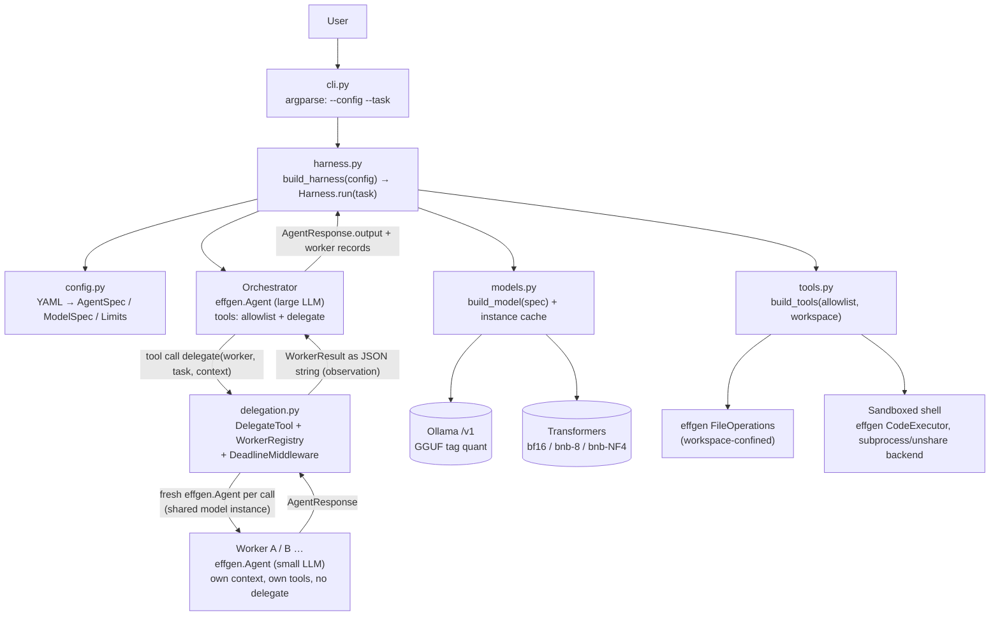
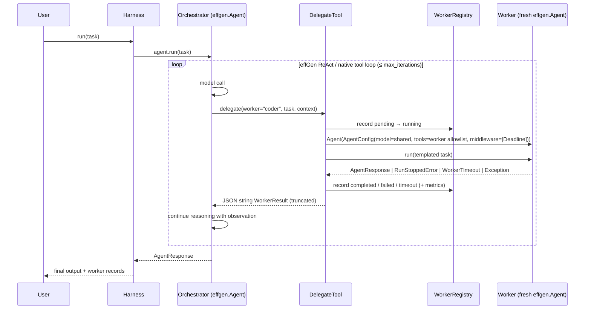

# Architecture

> **Status:** proposed. **No component below is implemented yet.**
> Mark a component *Implemented* only after its task in `docs/implementation-plan.md` is Completed.
> Facts about effGen and the source references behind them are in `docs/effgen-api-audit.md`.

## 1. Analysis of the smolagents reference diagram

The supplied diagram (gitdiagram of `huggingface/smolagents`) shows four layers.

| smolagents component | Responsibility | MVP? | effGen equivalent | Decision |
|---|---|---|---|---|
| CLI (`cli.py`) | Submit a task, run an agent | Yes (tiny) | `effgen` CLI exists but is effGen-centric | **Own ~50-line argparse CLI** |
| Gradio UI (`gradio_ui.py`) | Streams a run in the browser | No | `effgen/webui`, dashboard | Dropped |
| Web browser agent | Browser automation | No | — | Dropped (excluded) |
| Agent runtime (`agents.py`) | Multi-step ReAct loop, tool dispatch, managed agents | Yes | `Agent` loop (`core/agent*.py`) | **Reuse effGen** |
| Run memory (`memory.py`) | Per-agent step history | Yes | `AgentThread`, `ShortTermMemory` | **Reuse effGen** |
| Monitoring (`monitoring.py`) | Token/step tracking | Minimal | `AgentResponse` metrics, `ExecutionTracker`, ledger | **Reuse effGen**; no custom observability |
| Model adapters (`models.py`) | LLM provider abstraction | Yes | `effgen.models.load_model`, adapters | **Reuse effGen**; one thin `build_model(spec)` function |
| MCP client (`mcp_client.py`) | Tools from MCP servers | No | `tools/protocols/mcp*` | Dropped (excluded) |
| Multimodal types (`agent_types.py`) | Image/audio I/O | No | `core/messages.py` | Dropped |
| Serialization (`serialization.py`) | Safe result transport for remote executors | No | — | Dropped (no remote execution) |
| Tool framework (`tools.py`) | Tool base class, schemas | Yes | `BaseTool`, `@tool` | **Reuse effGen** |
| Default tools (`default_tools.py`) | Built-in tools incl. web search | Partial | `tools/builtin/*` | Reuse file ops + sandboxed shell; **no web tools** |
| Tool validation (`tool_validation.py`) | Validate tool definitions | Implicit | `ParameterSpec.validate`, `BaseTool.execute` | **Reuse effGen** |
| Local code executor | Run model-written Python | No (we are a tool-calling, not code-acting, harness) | `CodeExecutor` | Used only as the sandboxed **shell** backend |
| Remote executors + sandbox services | E2B/Docker/Modal | No | `DockerSandbox` | Dropped (excluded) |
| Hugging Face Hub | Share agents/tools | No | — | Dropped |
| LLM providers | Inference | Yes | Ollama (OpenAI-compatible), Transformers | **Reuse effGen** |

**What the diagram does not show** (taken from source: `src/smolagents/agents.py`):

- `MultiStepAgent(managed_agents=[...])` registers each managed agent as a tool. `_setup_managed_agents` gives it `inputs={task, additional_args}` and `output_type="string"`.
- The manager calls the agent like a tool (`execute_tool_call`, the `is_managed_agent` branch).
- `MultiStepAgent.__call__`:
  1. wraps the task in the `managed_agent.task` prompt template;
  2. calls `self.run(full_task)`, where `reset=True` by default, so **each delegation starts with fresh memory**;
  3. wraps the output in the `managed_agent.report` template;
  4. optionally appends a run summary (`provide_run_summary`).
- An exception becomes the observation "Error executing request to team member ... try again or request another team member".
- Managed agents may have their own managed agents; there is no depth cap and no timeout.

### Principles adopted from smolagents

1. **A worker is just a tool to the orchestrator.** Delegation happens inside the orchestrator's normal loop. The orchestrator sees the result as an observation and keeps reasoning.
2. **Fresh context per delegation.** The worker never sees parent history except the explicit task/context text. The parent never sees worker history except the returned report.
3. **Templated task and report envelopes**, so small workers get a clear contract.
4. **Errors become observations**, not crashes. The manager decides what to do next.

### Ideas borrowed from Pi (not in smolagents)

`pi-mono/packages/coding-agent/examples/extensions/subagent`:

- A **single** `delegate(worker, task)` tool addressing named workers, instead of one tool per worker. This keeps the orchestrator's tool list short.
- A **cap on returned child output** (Pi uses 50 KB). We cap the report at a configurable number of characters.
- Declarative worker definitions (name, description, model, tools). We put these in one YAML config file.
- Exact-match `oldText → newText` edit tool (`src/core/tools/edit.ts`). This is a *candidate* for task T4.3 if whole-file writes prove unreliable.

## 2. Why not effGen's built-in orchestration

Evidence and source references are in `docs/effgen-api-audit.md` §1.3.

- `SubAgentManager` does an up-front router decomposition, always runs on the **parent's model and tools**, and ignores per-subagent `model`, `tools` and `timeout`. That rules out heterogeneous workers.
- `MultiAgentOrchestrator` with the `HIERARCHICAL` pattern runs fixed decompose → run-all → synthesize phases with text-parsed subtasks. There is no mid-run delegation, and `TeamConfig.timeout` is not enforced. We keep it as a possible **comparison baseline** after MVP.
- **effGen explicitly supports an agent being run from inside another agent's tool.** Run scopes are keyed per agent, nested trackers are separate, and `FunctionTool` copies the context so the child is counted in the parent's ledger. That makes a ~100-line delegate tool the smallest correct solution.

## 3. Proposed architecture



Each box is effGen's code unless it names one of our modules: `cli.py`, `harness.py`, `config.py`, `models.py`, `tools.py`, `delegation.py`. The custom code target is **≤ ~600 lines of Python**, excluding tests.

### Proposed package layout (not yet created)

```
pyproject.toml                 # uv project; pins effgen==1.3.0 (or the audited commit)
src/smol_harness/
  __init__.py
  config.py      # dataclasses + YAML loader + validation
  models.py      # build_model(spec) -> effgen BaseModel; quant mapping; cache
  tools.py       # build_tools(names, workspace); pinned sandboxed shell
  delegation.py  # WorkerResult, WorkerRegistry, DeadlineMiddleware, DelegateTool
  harness.py     # wire orchestrator + workers; Harness.run(task) -> HarnessResult
  __main__.py    # CLI
configs/example.yaml
tests/           # unit tests use scripted effGen BaseModel fakes (no GPU / network)
```

## 4. Component responsibilities

| Module | Responsibility | Must NOT |
|---|---|---|
| `config.py` | Parse and validate one YAML file into frozen dataclasses: `ModelSpec(provider, model, base_url, quantization, dtype, context_length, request_timeout)`, `AgentSpec(name, description, model, tools, system_prompt, max_iterations)`, `Limits(worker_timeout_s, max_report_chars, max_delegations)`, `HarnessConfig(workspace, orchestrator, workers)`. Reject unknown tools, unknown quantization values for a provider, and duplicate names. | Load models or construct agents |
| `models.py` | `build_model(spec) -> effgen BaseModel` via `effgen.models.load_model`. Map our quantization enum to effGen kwargs. Cache instances by spec so identical specs share weights. | Implement inference, a provider base class, or quantization |
| `tools.py` | `build_tools(names, workspace) -> list[BaseTool]` from a fixed registry: `file_operations`, `shell` (later maybe `edit_file`). | Register web or network tools; implement path checks effGen already does |
| `delegation.py` | `DelegateTool` (an effGen `BaseTool`), `WorkerResult` / `WorkerRecord`, `WorkerRegistry` (in-memory lifecycle: `pending → running → completed / failed / timeout`), `DeadlineMiddleware`. | Run its own reasoning loop; merge histories |
| `harness.py` | Build the orchestrator and worker factories from config. `Harness.run(task) -> HarnessResult(output, success, termination, workers=[WorkerRecord...])`. | Re-implement `Agent.run` |
| `__main__.py` | `python -m smol_harness --config X --task "..." [--json]` | Interactive UI |

## 5. Orchestrator-worker execution flow



### Delegate tool contract (proposed)

- **Input:**
  - `worker`: enum of configured worker names.
  - `task`: string; must be self-contained.
  - `context`: optional string with the explicit context transfer, e.g. file paths and findings.
- **Output:** a JSON string, deliberately *not* a dict (audit §1.2):
  ```json
  {"delegation_id": "d1", "worker": "coder", "status": "completed|failed|timeout",
   "output": "...(truncated to max_report_chars)", "error": null,
   "termination": "done", "iterations": 4, "tool_calls": 3, "tokens_used": 2100, "duration_s": 41.2}
  ```
- **Failure semantics:**
  - The tool itself does **not** report `success: False` to effGen. A failed worker is a *successful* tool call whose payload says `status: "failed"`. This keeps effGen's `tool_failed` termination from ending the orchestrator run because of a worker failure. The orchestrator decides whether to retry, re-delegate or answer. **Verify in T2.2.**
  - Only harness bugs (an invalid worker name, or delegations over `max_delegations`) return an error string.
- **Task envelope:** a smolagents-style template. It says who the worker is and that it is helping a manager, then gives the task and context, and asks for an outcome with a short summary, details, files touched, and anything unresolved.

## 6. Subagent spawning strategy

- **Workers are preconfigured specs.** "Spawning" means constructing a fresh `effgen.Agent` from a spec at delegation time. That gives dynamic *instances* of static *definitions*. Free-form runtime-defined workers (model picks model or tools) are post-MVP.
- **Depth = 1 is enforced structurally:**
  - Only the orchestrator holds `delegate`.
  - Workers are built with `enable_sub_agents=False` and `mode=AgentMode.SINGLE`, and `config.py` rejects `delegate` in a worker tool list.
- **Execution is sequential.** effGen runs a turn's tool calls through `_execute_tool` one by one, and the Transformers engine serializes generation anyway. Parallel execution is post-MVP; effGen's `SubAgentManager.execute_parallel` / thread executors are the pattern to study then.
- **Lifecycle:** `WorkerRegistry` keeps an in-memory list of `WorkerRecord(delegation_id, worker, task, status, started_at, ended_at, result)`. It is exposed on `HarnessResult`. No persistence.

## 7. Context isolation strategy

| Concern | Mechanism |
|---|---|
| Separate histories | A new worker `Agent` per delegation (its own `ShortTermMemory` / `AgentThread`). The `Agent` is closed afterwards; the model instance survives (`close()` does not unload). |
| Explicit transfer | Only `task` + `context` strings reach the worker. No `_prior_steps` (a private API). |
| No merge back | The orchestrator sees only the JSON report. The worker's `AgentThread` is kept on the `WorkerRecord` for debugging, never injected into the parent. |
| Parent continuity | The orchestrator is one `Agent` running one `run()` call. Its own memory holds its own turns. |

## 8. Model loading design

The harness's provider vocabulary is deliberately tiny. It maps 1:1 to effGen calls.

| `provider` | effGen call | Quantization field accepted |
|---|---|---|
| `ollama` | `load_model(model, provider="openai_compatible", base_url=<default http://127.0.0.1:11434/v1>, context_length=…, timeout=…)` | `server` only (informational; the quant is defined by the Ollama tag, e.g. `qwen2.5-coder:7b-instruct-q4_K_M`) |
| `hf` | `load_model(model, engine="transformers", quantization_bits=<None/8/4>, torch_dtype=<bf16/fp16>, device_map="auto")` | `none` (with `dtype: bf16 \| fp16`), `bnb-8bit`, `bnb-4bit-nf4` |

- **Always pass `quantization_bits` explicitly**, including `None`, to defeat effGen's VRAM-based auto-quantization.
- `bnb-4bit-fp4` is rejected at config validation, because effGen hard-codes NF4.
- The model cache key is the full `ModelSpec`. Orchestrator and worker may share one instance when their specs are identical.
- **Hardware note:** RTX 4060 Laptop, 8 GB VRAM, 14 GB RAM. A realistic first pairing is an Ollama ~7B Q4 orchestrator with an HF ~1.5B NF4 worker. **Unverified**; VRAM co-residency must be measured in T3.4.

## 9. Tool execution boundaries

| Tool name (ours) | Backing effGen tool | Boundary |
|---|---|---|
| `file_operations` | `FileOperations(allowed_directories=[workspace])` | Path containment and credential deny-list (effGen) |
| `shell` | Thin subclass of `CodeExecutor(workdir=workspace)`. Exposes only `command` (+ optional `timeout` ≤ cap). Pins `language="bash"` and `network_enabled=False`, plus a configured memory limit. Process env sets `EFFGEN_SANDBOX_BACKEND=subprocess`. | Linux user + mount + net (+ pid) namespaces: writes only inside the workspace, private `/tmp`, no network, timeout. **Reads are not confined.** This is not a VM or container boundary. |
| `delegate` | ours | Orchestrator only |

- Repository search is a filename glob via `file_operations`, plus content search via `shell` (`grep -rn`).
- An exact-replace `edit_file` tool is a contingent task (T4.3).
- `BashTool` is **not** used: effGen documents it as not a sandbox. If the subprocess sandbox is unavailable on a host, the harness fails closed (no shell tool) rather than silently falling back.
- **Web tools are never constructed.** `config.py` rejects any tool name not in the harness registry, and a test asserts that no agent holds a web or network tool.

## 10. Execution limits

| Limit | Where | Mechanism |
|---|---|---|
| Max steps per agent | `AgentSpec.max_iterations` | `AgentConfig.max_iterations` (effGen) |
| Per-worker timeout | `Limits.worker_timeout_s` | `DeadlineMiddleware`: `before_model_call` / `before_tool_call` raise `WorkerTimeout` once the deadline has passed, which stops the worker run (middleware exceptions propagate, audit §1.8). Plus the HTTP `timeout` on Ollama and shell timeouts. **Cooperative:** it cannot pre-empt an in-flight Transformers `generate()`, so worst-case overrun is one generation. |
| Max depth | structural (= 1) | see §6 |
| Max delegations per run | `Limits.max_delegations` | Counter in `DelegateTool` |
| Report size | `Limits.max_report_chars` | Truncation in `DelegateTool` |
| Orchestrator wall clock | optional; same middleware | post-MVP unless needed |
| Failure propagation | `WorkerResult.status` / `error` | Exceptions (`RunStoppedError`, `BackendUnreachableError`, `WorkerTimeout`, others) are caught in `DelegateTool` and reported. Orchestrator errors propagate to the CLI (exit code ≠ 0). |

## 11. Key decisions and trade-offs

| # | Decision | Alternative rejected | Why |
|---|---|---|---|
| A1 | Agent-as-tool delegation via one `delegate` tool | effGen `SubAgentManager`; `MultiAgentOrchestrator` HIERARCHICAL | Only option with mid-loop, model-initiated delegation and per-worker models (audit §1.3) |
| A2 | Fresh worker `Agent` per delegation, shared model | Long-lived worker + `reset_memory()` | Fresh object guarantees isolation; construction is cheap when the model is an instance (same pattern as effGen's `_run_real_sub_agent`) |
| A3 | Report returned as JSON string, never `success: False` | Return dict / raise | effGen reduces dict outputs to selected keys and turns `success: False` into a tool failure that can end the parent run |
| A4 | Cooperative deadline via middleware | Thread kill / `with_timeout` async-exception | Safe; no torch-state corruption; uses effGen's documented hook semantics |
| A5 | Sandboxed shell via `CodeExecutor` subprocess backend | effGen `BashTool` | `BashTool` is documented as not a sandbox |
| A6 | Ollama via `openai_compatible` | Custom Ollama client | effGen supports it; no redundant provider abstraction |
| A7 | Scripted `BaseModel` fakes for unit tests | Real models in CI | Deterministic, CPU-only; effGen's own tests use the same pattern (`tests/unit/test_written_action_runs.py:_Scripted`) |
| A8 | Sequential workers only | Parallel | Explicit MVP scope; Transformers serializes anyway |
